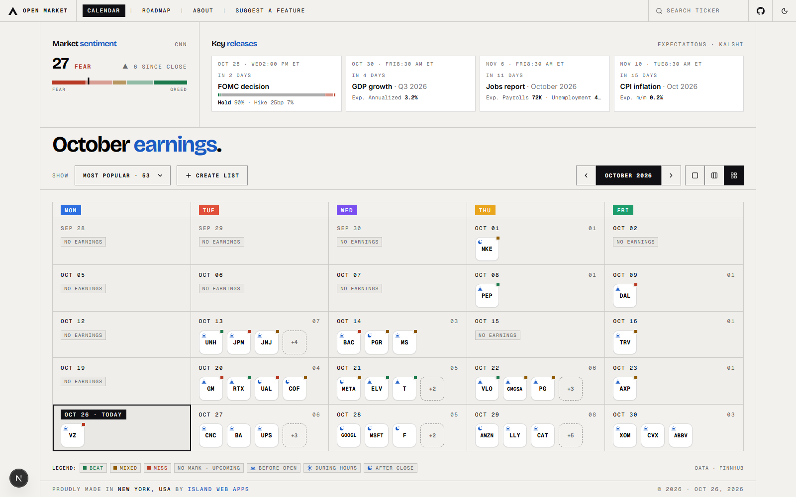

# Open Market

**Every free market tool in one place, built by the people who use it.**

Checking the market today means a dozen tabs: one site for earnings dates, another for the Fear & Greed Index, another for Fed odds, another for SEC filings, each with its own ads, sign-ups and paywalls. Open Market puts them on one page, free and open source, with no account needed.

It starts with an earnings calendar and market context. What comes next is up to its users: anyone can suggest a tool, vote on what gets built, or build it themselves.

<picture>
  <source media="(prefers-color-scheme: dark)" srcset="docs/images/calendar-dark.png">
  
</picture>

▶ **[Watch the 1-minute tour](docs/video/open-market-tour.webm)**: the market panel, the calendar, company details, search, views, ticker lists, and voting on the roadmap.

## What's in it today

**Earnings calendar**
- Every company reporting, by day, week or month, with the whole month fitting on one screen
- Each company marked by when it reports (before the open, during the day, after the close) and whether it beat, missed or was mixed against estimates
- Filter by Most popular (the Fortune 100), NYSE or Nasdaq, or make your own ticker lists
- Search any company reporting this month or the next two, and a watchlist kept in your browser

**Market context**
- The CNN Fear & Greed Index and its change since the last close
- The next Fed decision with Kalshi's odds of a cut, hold or hike, plus CPI, jobs and GDP dates and expectations

**Company details**
- EPS and revenue against estimates, with the surprise in percent
- An EPS surprise chart for the last four quarters
- One click to the company's earnings release and SEC filings

**Community roadmap**
- Suggest a feature from the menu: each idea becomes a short card on a public board, and repeats are merged into the idea they match
- Everyone votes ideas up or down, and the most wanted rise to the top of the in-app Roadmap page (`/roadmap`)

Works in light and dark, and on phones. See everything that's live and planned in `docs/features.html`.

## The idea

Good market tools exist, but they're scattered, and the free ones are usually a funnel into a paid plan. Open Market aims to be the one free place for them:

- **One place.** Earnings, sentiment, macro releases and company data side by side, with more tools added over time.
- **Free.** Built on free data sources, with no account, paywall or ads.
- **Community-run.** There's no company deciding what comes next. Users suggest and vote on features, build them, and help keep them working.

## Contributing

1. **Suggest:** post an idea with *Suggest a feature* in the app (or open an issue), and vote on other people's.
2. **Build:** pick something from the roadmap or your own idea, fork the repo and open a pull request at [github.com/FullPokerFace/open-market](https://github.com/FullPokerFace/open-market).
3. **Maintain:** review changes, fix what breaks and keep data sources working.

## Getting started

Needs Node.js, a free [Finnhub](https://finnhub.io) API key and a [MongoDB Atlas](https://www.mongodb.com/atlas) user. Copy `example.env` to `.env.local` and fill it in:

```bash
FINNHUB_API_KEY=your_key
MONGO_DB_USER=your_mongo_user
MONGO_DB_PASSWORD=your_mongo_password
# Optional: the "Suggest a feature" board (moderation and card titles by OpenAI)
OPEN_AI_KEY=your_openai_key
# Optional: emails each suggestion to you through Gmail SMTP
GMAIL_SENDER_ADDRESS=you@gmail.com
GMAIL_APP_PASSWORD=your_app_password
```

Then:

```bash
npm install
npm run dev
```

Open [http://localhost:3000](http://localhost:3000). Data from every source is saved in MongoDB as it comes in, so pages load fast and keep working when a source has a hiccup; each request to a source is logged in the server console.

Built with Next.js 16 (App Router), React 19, Tailwind CSS v4, shadcn/ui (Base UI) and MongoDB. Design notes are in `docs/DESIGN.md`.

## Testing

End-to-end tests use [Playwright](https://playwright.dev). Install it once:

```bash
npx playwright install chromium
```

```bash
npm run test:e2e           # against localhost:3000 (starts `npm run dev` if it isn't running)
npm run test:e2e:ui        # same, in Playwright's UI: watch each step on screen
npm run test:e2e:live      # against the live site, E2E_LIVE_URL in .env.local
npm run test:e2e:live:ui   # live site, in the UI
npx playwright show-report # HTML report of the last run
```

To re-record the tour video, run `npm run video:tour` against a production build or the live site (set `TOUR_URL`, e.g. `https://www.getopenmarket.app`; the default is localhost:3000). It saves `docs/video/open-market-tour.webm`, and like the tests it never writes real data.

Tests live in `e2e/`. They never write real data: suggestion posts and votes are answered by mocks in the browser, so a run doesn't call OpenAI, change the database or send email, and is safe against production.

## Credits

Data from [Finnhub](https://finnhub.io), [SEC EDGAR](https://www.sec.gov/edgar), [Kalshi](https://kalshi.com) and [CNN Fear & Greed](https://www.cnn.com/markets/fear-and-greed). Suggestion cards written with [OpenAI](https://openai.com). Design inspired by [ArtCraft](https://getartcraft.com).

Open Market is for information only and isn't investment advice.
